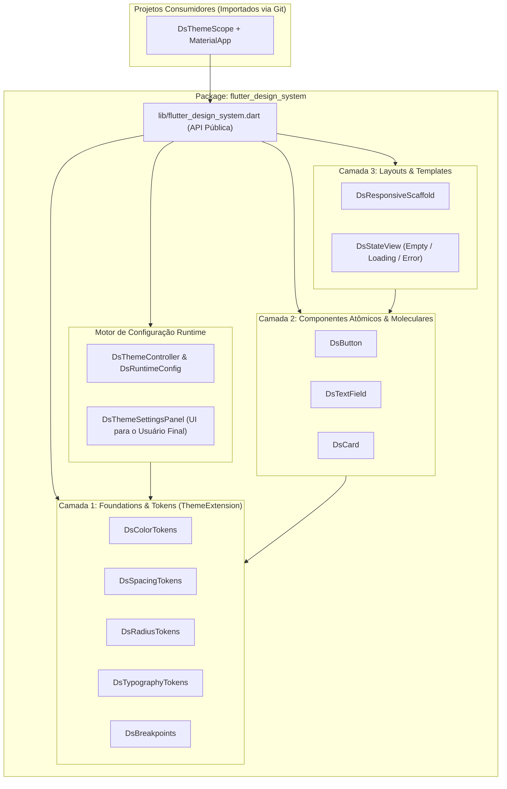

# Software Design Document (SDD) — Flutter Design System

**Versão:** 1.1.0  
**Data:** 2026-10-14  
**Status:** Implementado e Validado  

---

## 1. Introdução e Propósito

Este **Software Design Document (SDD)** especifica a arquitetura técnica, contratos de API, padrões de segurança/acessibilidade, regras de layout defensivo, configuração em **runtime pelo usuário final** e estratégia de testes do **Design System em Flutter (`flutter_design_system`)**.

O objetivo principal é fornecer um **pacote de frontend modular e reutilizável** que possa ser importado via **Git** por múltiplos projetos Flutter (Mobile, Web e Desktop), garantindo:
1. **Consistência visual e funcional** centralizada em um único repositório.
2. **Duplo Modo de Configuração:**
   - **Via Código (Desenvolvedor / White-Label):** usando `DsTheme.light(...)` e `DsTheme.dark(...)`.
   - **Em Runtime (Usuário Final do Sistema):** usando `DsThemeController`, `DsThemeScope`, `DsRuntimeConfig` (serializável para banco local/API) e o painel pronto `DsThemeSettingsPanel`.
3. **Tolerância Zero a Overflow** através de *defensive constraints* embutidas na base de cada componente.
4. **Cobertura de Testes Automatizados** (unitários e de widget) contra regressões visuais ou quebras de layout.

---

## 2. Diretrizes Arquiteturais e Regras de Engenharia

| Diretriz | Regra de Implementação |
| :--- | :--- |
| **Desacoplamento de Negócio** | O Design System **nunca** conhece regras de domínio, modelos de API ou rotas específicas de um projeto final. Ele recebe apenas parâmetros primitivos, objetos de configuração visuais e callbacks (`VoidCallback`, `ValueChanged<T>`). |
| **Zero Dados Fictícios** | Nenhum componente ou tela de catálogo conterá métricas falsas, gráficos simulados ou dados de negócio inventados. Estados sem conteúdo utilizam representações técnicas neutras (*Ready / Empty / Loading / Error State*). |
| **Defesa contra Overflow** | Textos internos em botões, cabeçalhos, inputs e listas utilizam obrigatoriamente `Flexible`/`Expanded` e `TextOverflow.ellipsis` (ou `Wrap` quando aplicável), suportando `TextScaler` elevado sem gerar `RenderFlex overflowed`. |
| **Segurança por Padrão** | Campos sensíveis (`DsTextField.password`) desabilitam autocorreção, sugestões de teclado (`enableSuggestions: false`, `autocorrect: false`) e ocultam caracteres por padrão (`obscureText: true`). Desserialização de preferências (`DsRuntimeConfig.fromMap`) valida tipos e limites antes de instanciar objetos. |
| **Acessibilidade (a11y)** | Todos os componentes interativos respeitam área mínima de toque, expõem `Semantics` claros para leitores de tela e preservam navegação por teclado (`FocusNode`). |

---

## 3. Arquitetura do Sistema e Estrutura de Diretórios



### 3.1. Árvore de Arquivos do Repositório

```text
flutter_design_system/
├── docs/
│   ├── SDD.md                                      # Este documento de especificação
│   └── brainstorming/flutter_design_system/        # Histórico versionado (v1, v2, v3...)
├── pubspec.yaml                                    # Definição do pacote reutilizável
├── lib/
│   ├── flutter_design_system.dart                  # Único ponto de exportação (API pública)
│   └── src/
│       ├── tokens/
│       │   ├── ds_color_tokens.dart                # Paletas Light, Dark e contratos de cor
│       │   ├── ds_spacing_tokens.dart              # Escala de espaçamento (4px grid)
│       │   ├── ds_radius_tokens.dart               # Raios de borda padronizados
│       │   └── ds_typography_tokens.dart           # Escala tipográfica
│       ├── theme/
│       │   ├── ds_theme.dart                       # Construtor de ThemeData (light, dark, custom)
│       │   ├── ds_theme_controller.dart            # Estado reativo e serialização de preferências em runtime
│       │   └── ds_theme_extensions.dart            # BuildContext extensions (context.dsColors, context.dsThemeController)
│       ├── foundations/
│       │   └── ds_breakpoints.dart                 # Breakpoints responsivos (compact, medium, expanded)
│       ├── components/
│       │   ├── button/
│       │   │   └── ds_button.dart                  # Botão com variantes, loading e anti-overflow
│       │   ├── input/
│       │   │   └── ds_text_field.dart              # Input padronizado, validação e modo senha seguro
│       │   ├── card/
│       │   │   └── ds_card.dart                    # Superfície contida com borda e espaçamento semântico
│       │   ├── feedback/
│       │   │   └── ds_state_view.dart              # Estado neutro (vazio, carregando, erro)
│       │   └── settings/
│       │       └── ds_theme_settings_panel.dart    # Painel de UI para o usuário final personalizar o tema em runtime
│       └── layouts/
│           └── ds_responsive_scaffold.dart         # Shell adaptativo (BottomNav / Rail / Sidebar)
├── test/
│   ├── tokens/
│   │   └── ds_theme_test.dart                      # Testes de tokens, copyWith e interpolação (lerp)
│   ├── theme/
│   │   └── ds_runtime_config_test.dart             # Testes de serialização e customização em runtime
│   ├── components/
│   │   ├── ds_button_test.dart                     # Testes funcionais + Torture Test de overflow
│   │   ├── ds_text_field_test.dart                 # Testes de input, erro, segurança de senha e overflow
│   │   ├── ds_card_test.dart                       # Testes de renderização e constraints
│   │   └── ds_state_view_test.dart                 # Testes de estados neutros
│   └── layouts/
│       └── ds_responsive_scaffold_test.dart        # Testes de troca automática Mobile/Tablet/Desktop
└── example/                                        # App Showcase Técnico para inspeção em tempo real
    ├── pubspec.yaml
    └── lib/
        └── main.dart
```

---

## 4. Especificação Detalhada das Camadas

### 4.1. Camada 1: Design Tokens e `ThemeExtension`

Todos os tokens visuais implementam `ThemeExtension<T>` do Flutter para permitir:
1. Acesso tipado via `BuildContext` (sem valores mágicos espalhados).
2. Interpolação contínua (`lerp`) em animações de troca de tema.
3. Sobrescrita total ou parcial (`copyWith`) por qualquer projeto consumidor ou pelo usuário em runtime.

- **`DsColorTokens`**: `background`, `surface`, `surfaceVariant`, `textPrimary`, `textSecondary`, `textDisabled`, `textOnPrimary`, `primary`, `primaryContainer`, `secondary`, `success`, `warning`, `error`, `border`, `divider`.
- **`DsSpacingTokens`**: `xxs` (`4.0`), `xs` (`8.0`), `sm` (`12.0`), `md` (`16.0`), `lg` (`24.0`), `xl` (`32.0`), `xxl` (`48.0`).
- **`DsRadiusTokens`**: `none` (`0.0`), `sm` (`6.0`), `md` (`10.0`), `lg` (`16.0`), `full` (`999.0`).
- **`DsBreakpoints`**: `compact` (`< 600px`), `medium` (`600px–1023px`), `expanded` (`>= 1024px`).

---

### 4.2. Camada 2: Componentes Base e Painel de Configuração Runtime

1. **`DsButton`**: Variantes (`primary`, `secondary`, `outline`, `ghost`, `danger`), tamanhos (`sm`, `md`, `lg`), bloqueio contra duplo clique em `isLoading` e texto protegido com `Flexible` + `TextOverflow.ellipsis`.
2. **`DsTextField` / `DsTextField.password`**: Rótulo, erro, helper e modo de senha seguro (`obscureText: true`, `enableSuggestions: false`, `autocorrect: false`).
3. **`DsCard`**: Container semântico com bordas, superfície do tema e clip anti-alias.
4. **`DsStateView`**: Estados neutros reais (`empty`, `loading`, `error`).
5. **`DsThemeSettingsPanel`**: Painel pronto de interface para que o **usuário final do sistema** personalize em tempo de execução:
   - Modo de Tema (`Sistema`, `Claro`, `Escuro`);
   - Cor de Destaque (`DsBrandColorOption`);
   - Estilo de Bordas (`DsCornerStyle`: `sharp`, `subtle`, `standard`, `rounded`);
   - Densidade de Espaçamento (`DsVisualDensity`: `compact`, `standard`, `comfortable`).

---

## 5. Como Outros Projetos Consomem via Git e Configuram (Código vs Runtime)

### 5.1. Importação Oficial via Git no `pubspec.yaml`

Em qualquer outro projeto Flutter, adicione a dependência apontando para o repositório Git público:

```yaml
dependencies:
  flutter:
    sdk: flutter
  flutter_design_system:
    git:
      url: https://github.com/RuyXingubit/flutter-design-system.git
      ref: main # Ou uma tag específica (ex: v0.1.0) para travar a versão
```

### 5.2. Modo 1: Configuração Estática via Código (Fixo por Projeto)

Quando a identidade visual é definida apenas pelo código do projeto consumidor:

```dart
MaterialApp(
  theme: DsTheme.light(
    colorsOverride: DsColorTokens.light().copyWith(
      primary: const Color(0xFF059669),
    ),
  ),
  darkTheme: DsTheme.dark(),
  home: const MinhaTela(),
);
```

### 5.3. Modo 2: Configuração Dinâmica em Runtime pelo Usuário do Sistema

Quando o usuário final do sistema pode escolher tema, cor de destaque, arredondamento de bordas e densidade de espaçamento em tempo real (com suporte a salvar no `SharedPreferences` ou no banco/API via `toMap` / `fromMap`):

```dart
class MeuAppConfiguravel extends StatefulWidget {
  const MeuAppConfiguravel({super.key, this.savedPrefsMap});
  final Map<String, Object?>? savedPrefsMap;

  @override
  State<MeuAppConfiguravel> createState() => _MeuAppConfiguravelState();
}

class _MeuAppConfiguravelState extends State<MeuAppConfiguravel> {
  late final DsThemeController _themeController = DsThemeController(
    initialConfig: widget.savedPrefsMap != null
        ? DsRuntimeConfig.fromMap(widget.savedPrefsMap!)
        : const DsRuntimeConfig(),
    onConfigChanged: (newConfig) {
      // Salve newConfig.toMap() no SharedPreferences ou API do usuário!
    },
  );

  @override
  void dispose() {
    _themeController.dispose();
    super.dispose();
  }

  @override
  Widget build(BuildContext context) {
    return DsThemeScope(
      controller: _themeController,
      child: ListenableBuilder(
        listenable: _themeController,
        builder: (context, _) {
          return MaterialApp(
            themeMode: _themeController.themeMode,
            theme: _themeController.lightTheme,
            darkTheme: _themeController.darkTheme,
            home: const TelaDeConfiguracoesDoUsuario(),
          );
        },
      ),
    );
  }
}
```

E dentro de qualquer tela de preferências do projeto consumidor, basta renderizar o componente pronto `DsThemeSettingsPanel()` (ou acionar programaticamente via `context.dsThemeController.setPrimaryColor(...)`).
