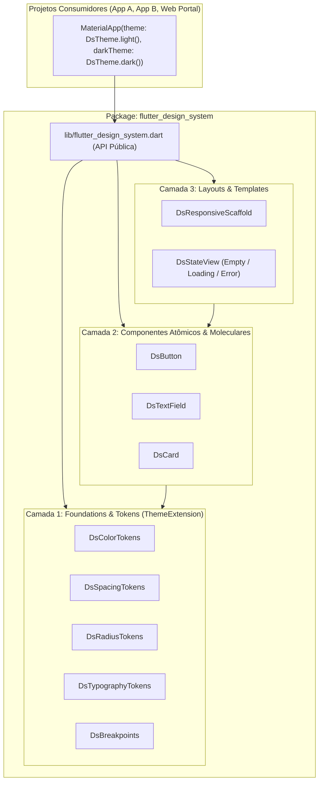

# Software Design Document (SDD) — Flutter Design System

**Versão:** 1.0.0  
**Data:** 2026-10-14  
**Status:** Proposto para Aprovação  

---

## 1. Introdução e Propósito

Este **Software Design Document (SDD)** especifica a arquitetura técnica, contratos de API, padrões de segurança/acessibilidade, regras de layout defensivo e estratégia de testes para a construção de um **Design System em Flutter (`flutter_design_system`)**.

O objetivo principal é fornecer um **pacote de frontend modular e reutilizável** que possa ser importado por múltiplos projetos Flutter (Mobile, Web e Desktop), garantindo:
1. **Consistência visual e funcional** centralizada em um único código-fonte.
2. **Suporte Multi-Tema / White-Label** nativo (Light, Dark e customização por projeto consumidor).
3. **Tolerância Zero a Overflow** através de *defensive constraints* embutidas na base de cada componente.
4. **Cobertura de Testes Automatizados** (unitários e de widget) contra regressões visuais ou quebras de layout.

---

## 2. Diretrizes Arquiteturais e Regras de Engenharia

| Diretriz | Regra de Implementação |
| :--- | :--- |
| **Desacoplamento de Negócio** | O Design System **nunca** conhece regras de domínio, modelos de API ou rotas específicas de um projeto final. Ele recebe apenas parâmetros primitivos, objetos de configuração visuais e callbacks (`VoidCallback`, `ValueChanged<T>`). |
| **Zero Dados Fictícios** | Nenhum componente ou tela de catálogo conterá métricas falsas, gráficos simulados ou dados de negócio inventados. Estados sem conteúdo utilizam representações técnicas neutras (*Ready / Empty / Loading / Error State*). |
| **Defesa contra Overflow** | Textos internos em botões, cabeçalhos, inputs e listas utilizam obrigatoriamente `Flexible`/`Expanded` e `TextOverflow.ellipsis` (ou `Wrap` quando aplicável), suportando `TextScaler` elevado sem gerar `RenderFlex overflowed`. |
| **Segurança por Padrão** | Campos sensíveis (`DsTextField.password`) desabilitam autocorreção, sugestões de teclado (`enableSuggestions: false`, `autocorrect: false`) e ocultam caracteres por padrão (`obscureText: true`). |
| **Acessibilidade (a11y)** | Todos os componentes interativos respeitam área mínima de toque (`48x48` dp), expõem `Semantics` claros para leitores de tela e preservam navegação por teclado (`FocusNode`). |

---

## 3. Arquitetura do Sistema e Estrutura de Diretórios



### 3.1. Árvore de Arquivos do Repositório

```text
flutter_design_system/
├── docs/
│   ├── SDD.md                                      # Este documento de especificação
│   └── brainstorming/flutter_design_system/        # Histórico versionado (v1, v2...)
├── pubspec.yaml                                    # Definição do pacote reutilizável
├── lib/
│   ├── flutter_design_system.dart                  # Único ponto de exportação (API pública)
│   └── src/
│       ├── tokens/
│       │   ├── ds_color_tokens.dart                # Paletas Light, Dark e contratos de cor
│       │   ├── ds_spacing_tokens.dart              # Escala de espaçamento (4px grid)
│       │   ├── ds_radius_tokens.dart               # Raios de borda padronizados
│       │   └── ds_typography_tokens.dart           # Escala tipográfica
│       ├── theme/
│       │   ├── ds_theme.dart                       # Construtor de ThemeData (light, dark, custom)
│       │   └── ds_theme_extensions.dart            # BuildContext extensions (context.dsColors, etc.)
│       ├── foundations/
│       │   └── ds_breakpoints.dart                 # Breakpoints responsivos (compact, medium, expanded)
│       ├── components/
│       │   ├── button/
│       │   │   └── ds_button.dart                  # Botão com variantes, loading e anti-overflow
│       │   ├── input/
│       │   │   └── ds_text_field.dart              # Input padronizado, validação e modo senha seguro
│       │   ├── card/
│       │   │   └── ds_card.dart                    # Superfície contida com borda e espaçamento semântico
│       │   └── feedback/
│       │       └── ds_state_view.dart              # Estado neutro (vazio, carregando, erro)
│       └── layouts/
│           └── ds_responsive_scaffold.dart         # Shell adaptativo (BottomNav / Rail / Sidebar)
├── test/
│   ├── tokens/
│   │   └── ds_theme_test.dart                      # Testes de tokens, copyWith e interpolação (lerp)
│   ├── components/
│   │   ├── ds_button_test.dart                     # Testes funcionais + Torture Test de overflow
│   │   ├── ds_text_field_test.dart                 # Testes de input, erro, segurança de senha e overflow
│   │   ├── ds_card_test.dart                       # Testes de renderização e constraints
│   │   └── ds_state_view_test.dart                 # Testes de estados neutros
│   └── layouts/
│       └── ds_responsive_scaffold_test.dart        # Testes de troca automática Mobile/Tablet/Desktop
└── example/                                        # App Showcase Técnico para inspeção em tempo real
    ├── pubspec.yaml
    └── lib/
        └── main.dart
```

---

## 4. Especificação Detalhada das Camadas

### 4.1. Camada 1: Design Tokens e `ThemeExtension`

Todos os tokens visuais implementam `ThemeExtension<T>` do Flutter para permitir:
1. Acesso tipado via `BuildContext` (sem valores mágicos espalhados).
2. Interpolação contínua (`lerp`) em animações de troca de tema.
3. Sobrescrita total ou parcial (`copyWith`) por qualquer projeto consumidor.

#### A. Tokens de Cor (`DsColorTokens`)
- **Superfícies:** `background`, `surface`, `surfaceVariant`
- **Textos e Ícones:** `textPrimary`, `textSecondary`, `textDisabled`, `textOnPrimary`
- **Semânticos / Marca:** `primary`, `primaryContainer`, `secondary`, `success`, `warning`, `error`
- **Estruturais:** `border`, `divider`

#### B. Tokens de Espaçamento (`DsSpacingTokens` — Grid Base 4px)
| Token | Valor (dp) | Uso Recomendado |
| :--- | :---: | :--- |
| `xxs` | `4.0` | Espaçamento mínimo entre ícone e badge |
| `xs` | `8.0` | Espaçamento interno compacto (elementos inline) |
| `sm` | `12.0` | Padding vertical de inputs e botões |
| `md` | `16.0` | Padding padrão de cards e margens mobile |
| `lg` | `24.0` | Separação entre seções e margens tablet |
| `xl` | `32.0` | Margens amplas desktop |
| `xxl` | `48.0` | Respiro estrutural de página |

#### C. Tokens de Raio de Borda (`DsRadiusTokens`)
- `none` (`0.0`), `sm` (`6.0`), `md` (`10.0`), `lg` (`16.0`), `full` (`999.0`).

#### D. Breakpoints Responsivos (`DsBreakpoints`)
- **`compact` (Mobile):** largura `< 600px`
- **`medium` (Tablet):** largura `>= 600px` e `< 1024px`
- **`expanded` (Desktop / Web):** largura `>= 1024px`

---

### 4.2. Camada 2: Contratos dos Componentes Base

#### 1. `DsButton`
- **Variantes (`DsButtonVariant`):** `primary`, `secondary`, `outline`, `ghost`, `danger`.
- **Tamanhos (`DsButtonSize`):** `sm`, `md`, `lg` (garantindo área mínima de toque interativa).
- **Propriedades:**
  - `String label` (obrigatório)
  - `VoidCallback? onPressed`
  - `bool isLoading` (quando `true`, desabilita cliques múltiplos acidentais e exibe indicador dimensionado)
  - `bool isExpanded` (quando `true`, ocupa a largura máxima disponível do pai)
  - `IconData? leadingIcon`, `IconData? trailingIcon`
- **Regra Anti-Overflow:** O `Row` interno usa `mainAxisSize: MainAxisSize.min` (ou `max` se `isExpanded`), envolvendo o `Text(label)` em um `Flexible` com `maxLines: 1` e `overflow: TextOverflow.ellipsis`.

#### 2. `DsTextField`
- **Construtores:** `DsTextField(...)` padrão e `DsTextField.password(...)` (com botão de alternância de visibilidade e flags de segurança ativas).
- **Propriedades:**
  - `String label`
  - `String? hintText`, `String? helperText`, `String? errorText`
  - `TextEditingController? controller`
  - `ValueChanged<String>? onChanged`
  - `bool enabled`, `bool readOnly`
  - `Widget? prefixIcon`, `Widget? suffixIcon`
- **Regra Anti-Overflow:** Rótulos (`label`), mensagens de erro (`errorText`) e textos de ajuda (`helperText`) permitem quebra de linha controlada (`maxLines: 2`, `overflow: TextOverflow.ellipsis`) para nunca estourar vertical ou horizontalmente.

#### 3. `DsCard`
- **Propriedades:**
  - `Widget child`
  - `EdgeInsetsGeometry? padding` (padrão: `context.dsSpacing.md`)
  - `VoidCallback? onTap` (adiciona `InkWell` com `borderRadius` sincronizado ao token)
  - `bool hasBorder` (padrão: `true`)
- **Regra Anti-Overflow:** Empacota o conteúdo respeitando os limites do componente pai e clipa bordas com `Clip.antiAlias`.

#### 4. `DsStateView`
- **Objetivo:** Representar estados neutros reais (`loading`, `empty`, `error`) em qualquer tela sem inventar dados falsos.
- **Propriedades:**
  - `String title`
  - `String? description`
  - `IconData? icon`
  - `String? actionLabel`, `VoidCallback? onAction`
  - `bool isLoading`

---

### 4.3. Camada 3: Layout Responsivo (`DsResponsiveScaffold`)

Componente de estrutura de página ("Frontend Shell") que adapta a navegação automaticamente conforme a largura da janela (`LayoutBuilder`):
- **`compact` (< 600px):** Renderiza `NavigationBar` inferior.
- **`medium` (600px – 1023px):** Renderiza `NavigationRail` lateral compacto.
- **`expanded` (>= 1024px):** Renderiza `Sidebar` lateral expandida com rótulos visíveis.
- Preserva o `body` central protegido dentro de área segura (`SafeArea`) sem perder estado ao redimensionar a janela (Web/Desktop).

---

## 5. Como Outros Projetos Consumirão este Design System

### 5.1. Importação no `pubspec.yaml` do Projeto Consumidor

```yaml
dependencies:
  flutter:
    sdk: flutter
  flutter_design_system:
    git:
      url: https://seu-repositorio/flutter_design_system.git
      ref: v1.0.0 # Tag imutável para segurança de versão
```
*(Durante o desenvolvimento local na mesma máquina, também pode ser referenciado via `path: ../flutter design system`).*

### 5.2. Inicialização no Projeto Consumidor

```dart
import 'package:flutter/material.dart';
import 'package:flutter_design_system/flutter_design_system.dart';

class MeuOutroProjetoApp extends StatelessWidget {
  const MeuOutroProjetoApp({super.key});

  @override
  Widget build(BuildContext context) {
    return MaterialApp(
      theme: DsTheme.light(),
      darkTheme: DsTheme.dark(),
      home: const MinhaTelaInicial(),
    );
  }
}
```

### 5.3. Customização White-Label (Opcional por Projeto)
Caso um projeto futuro tenha outra cor primária de marca, basta injetar:
```dart
theme: DsTheme.light(
  colorsOverride: DsColorTokens.light().copyWith(
    primary: const Color(0xFF0066CC),
  ),
),
```

---

## 6. Estratégia de Testes e Qualidade (Obrigatória por Feature)

Cada módulo entregue no escopo inicial terá sua suíte em `test/` cobrindo:
1. **Testes Unitários de Tokens e Temas:**
   - Validação de `copyWith` e interpolação `lerp(a, b, 0.5)` em todos os `ThemeExtension`.
2. **Testes Funcionais de Componentes:**
   - Clique, bloqueio quando `isLoading: true` ou `enabled: false`, alternância de visibilidade de senha no `DsTextField.password`.
3. **Torture Tests de Layout Defensivo (Anti-Overflow):**
   - Renderização do componente dentro de um `SizedBox(width: 200)` com uma string de 200 caracteres e `MediaQuery(data: MediaQueryData(textScaler: TextScaler.linear(2.0)))` garantindo zero exceções de `RenderFlex overflowed`.
4. **Teste de Responsividade (`DsResponsiveScaffold`):**
   - Alteração dinâmica do tamanho da tela no `WidgetTester` (`360x800` -> `800x1024` -> `1440x900`) verificando a transição entre BottomBar, Rail e Sidebar.

---

## 7. Plano de Execução do Escopo Inicial

A implementação seguirá estritamente a aprovação etapa por etapa:

1. **Etapa 1 — Fundação & Tokens (`ThemeExtension`)**: Inicialização do pacote Flutter, tokens (`DsColorTokens`, `DsSpacingTokens`, `DsRadiusTokens`, `DsTypographyTokens`), `DsTheme` (Light/Dark/Custom), `DsBreakpoints` e testes unitários.
2. **Etapa 2 — Componentes Base (`DsButton`, `DsTextField`, `DsCard`)**: Implementação com constraints defensivas, segurança de input e suíte de testes de widget + anti-overflow.
3. **Etapa 3 — Layouts & Estados (`DsStateView`, `DsResponsiveScaffold`)**: Implementação do shell adaptativo Mobile/Tablet/Desktop e estados neutros com testes de breakpoint.
4. **Etapa 4 — Catálogo Técnico (`example/`)**: App interativo para inspecionar tokens, componentes, temas e responsividade na prática.
